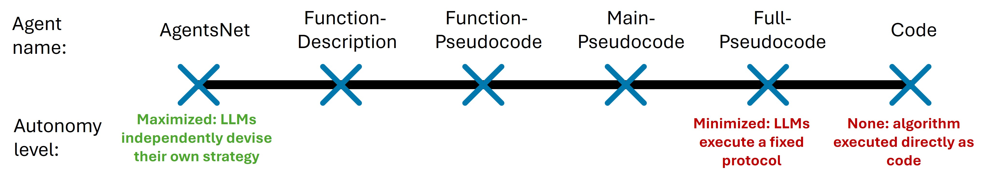

# Symbolic Guidance Taxonomy (SGT)

[](LICENSE)
[](https://cyprusconferences.org/aamas2026/)
[](https://arxiv.org/abs/2507.08616)

Code and experiment harness for **"Symbolic Guidance for LLM Agents in Distributed Multiagent Coordination"** (Ben Rachmut, Ning Zhang, Yevgeniy Vorobeychik, William Yeoh — Washington University in St. Louis), AAMAS 2026.

LLM agents left to devise their own distributed coordination strategy — the [AgentsNet](https://github.com/floriangroetschla/AgentsNet) setting — coordinate inconsistently, especially on harder problems. This repository asks what happens when you hand them part of a classical distributed algorithm instead. The **Symbolic Guidance Taxonomy (SGT)** defines a spectrum of agent types between "no guidance at all" and "execute this exact protocol", and this code runs all of them over three graph coordination problems, two difficulty variants each, and three LLMs.

The headline result: **intermediate guidance wins**. Partial pseudocode consistently beats the unguided AgentsNet baseline, and often beats full algorithmic specification. Guidance derived from a *local heuristic* (MIS) transfers well; guidance derived from a *global exhaustive search* (distributed DFS/backtracking) mostly does not.

---

## The taxonomy

A guidance strategy is a mapping `G(S, E; A) → I`: given a reference algorithm `A`, `S` selects which parts of it are revealed, `E` the form they take, and `I` is the guidance block the agent receives. Each agent type is one `(S, E)` pair, and the types order themselves along an autonomy spectrum.

| Agent type (paper) | `AgentType` in [globals_.py](globals_.py) | What the agent is given | Autonomy |
|---|---|---|---|
| AgentsNet agent *(baseline)* | `FreeForm` | Task description + output requirement only | Maximal |
| Function-description agent | `FunctionDescriptionOnly` | Natural-language descriptions of the helper functions | High |
| Function-pseudocode agent | `FunctionPseudoCodeOnly` | Pseudocode for the helper functions, but not how to use them | Medium |
| Main-pseudocode agent | `MainPseudocodeOnly` | Pseudocode of the main loop; helpers left unspecified | Medium |
| Full-pseudocode agent | `CompletePseudoCode` | The complete algorithm: main loop, helper bodies, tie-breaking | Low |
| Code agent *(oracle)* | `Code` | Nothing — the algorithm runs directly in Python, no LLM involved | None |

`AgentType.HeuristicHintGuided` also exists in the code (compact natural-language heuristics, e.g. tie-breaking rules only). It is implemented for every task but is not among the agent types reported in the paper; it is kept here for anyone who wants to run it.

## Problems, variants, and reference algorithms

Each problem comes in a **local** variant, solvable by local heuristics, and a **global** variant, where optimality requires coordination across the whole graph.

| Problem | Local variant (`ProblemLevel.poly`) | Global variant (`ProblemLevel.hard`) |
|---|---|---|
| Coloring | (Δ+1)-coloring | 3-coloring |
| Matching | Maximal matching | Maximum matching |
| Vertex cover | Minimal vertex cover | Minimum vertex cover |

The algorithm `A` whose parts become guidance is selected by `AlgoType`:

- `AlgoType.incomplete` — the **MIS heuristic** (local, tentative-propose/commit). Used for the local variants and as one of the two options for the global variants.
- `AlgoType.complete` — **distributed DFS / backtracking search** (global, exhaustive). Global variants only.
- `AlgoType.algo_independent` — no algorithm is referenced; this is where the `FreeForm` baseline lives.

Quality is reported as **sum of squared error (SSE)** against correctness (local variants) or against the optimum (global variants); see `get_SSE_easy` / `get_SSE_hard` in [LiteralMessagePassing.py](LiteralMessagePassing.py). Optima are computed exactly by the solvers in [optimal_solver_graph_coloring.py](optimal_solver_graph_coloring.py), [optimal_solver_maximum_matching.py](optimal_solver_maximum_matching.py), and [optimal_solutions_scripts.py](optimal_solutions_scripts.py).

---

## Installation

```bash
conda create -n sgt python=3.11 -y
conda activate sgt
pip install langchain langchain-openai langchain-ollama langchain-google-genai langchain-anthropic langgraph \
            python-dotenv pandas scipy networkx matplotlib numpy==1.26.4
```

### Model access

Create a `.env` file in the repository root (it is read by `load_dotenv(override=True)` in [main_v2.py](main_v2.py)):

```bash
# Hosted models (Gemini, DeepSeek, ... routed through OpenRouter)
OPENROUTER_API_KEY=sk-or-...
OPENROUTER_BASE_URL=https://openrouter.ai/api/v1

# Optional tuning
LMP_REQUEST_TIMEOUT=60     # per-request timeout, seconds
LMP_MAX_CONCURRENCY=1      # concurrent agent calls
```

If `OPENROUTER_*` is absent, the OpenAI-compatible client falls back to `OPENAI_API_KEY` / `OPENAI_BASE_URL`. Local models are served by [Ollama](https://ollama.com) at `http://localhost:11434`:

```bash
ollama pull llama3
ollama pull qwen2.5:7b-instruct
```

Which client is used for a given model name is decided by the `MODEL_PROVIDER` table at the top of [main_v2.py](main_v2.py) (`openai` | `ollama` | `google-genai` | `anthropic` | `together`). **Add your model there before using it** — unknown model names are skipped with a warning.

---

## Running experiments

### 1. Generate the graphs

Runs load pre-generated graphs from `graphs/`; they are not generated on the fly.

```bash
python generate_graphs.py --graph_sizes 16 --samples_per_graph_model 5 --seed 42
```

This writes `graphs/graph_{ws,ba,dt}_16_{0..4}.json` (plus a PNG preview each) for the three topology families used in the paper: Watts–Strogatz small-world (`ws`), Barabási–Albert scale-free (`ba`), and Delaunay triangulation (`dt`). Every instance records its own deterministic seed, node names, diameter, and max degree.

### 2. Run a sweep

```bash
python main_v2.py --models google/gemini-2.5-flash
```

**Read this before your first run.** `main_v2.py` is a sweep runner, not a conventional CLI. The set of (task, problem level, algorithm, agent type) combinations comes from the `run_plan` dictionary returned by `get_dict_for_main()` inside the file, and `__main__` loops over it, building a fresh parser per combination. So:

- To choose **what** to run, edit `get_dict_for_main()` in [main_v2.py](main_v2.py). Several ready-made plans — one per figure in the paper — are present in that function, commented out.
- `--task`, `--algo_type`, and `--symbolic_level` are supplied by that loop. Passing them on the command line pins every iteration to one value and defeats the sweep.
- Flags that are safe and useful to pass: `--models`, `--graph_size`, `--graph_models`, `--samples_per_graph_model`, `--start_from_sample`, `--seed`, `--local_graphs_dir`, `--missing_run_file`.
- Graph sizes are the `for graph_s in [16]` loop in `__main__`; `--graph_size` overrides it.

Round count is not configurable per run: each instance uses **2D+1** synchronous message-passing rounds, where D is the graph diameter, so every agent type gets the same communication budget.

### 3. Collect the output

Results land under `results/<graph_size>,<algo_type>,<task>,<problem_level>,<agent_type>/`, one JSON per instance. Each file holds the full agent transcripts plus the graph and the scoring:

| Field | Meaning |
|---|---|
| `answers`, `transcripts` | Final per-agent answers and the complete message log |
| `graph`, `num_nodes`, `diameter`, `max_degree` | The instance, in node-link form |
| `rounds` | Rounds actually run (2D+1) |
| `score`, `score_opt` | Task score; score against the optimum |
| `SSE_easy`, `SSE_hard`, `norm_SSE_easy`, `norm_SSE_hard` | Error metrics for the local and global variants |
| `required_calculations` | Per-agent bookkeeping of the computation the task demanded |
| `agent_type`, `algorithm_type`, `problem_level`, `model_name` | The experimental cell |
| `num_fallbacks`, `num_failed_json_parsings_after_retry`, `num_failed_answer_parsings_after_retry` | Protocol-failure counters |
| `commit_hash`, `graph_generator`, `graph_index` | Provenance |

### 4. Figures and tables

```bash
python create_figures_v2.py --roots results --out-dir figs
```

Writes the paper's bar charts (PDF + PNG) into `figs/`, mirrors every figure into `figs/all_figures/`, and prints the numeric tables — mean `ln(1+SSE)` ± SEM per agent type, split by model, task, and algorithm — to stdout. Useful flags: `--metric {sse,norm_sse,score}`, `--sse-transform {log1p,none}`, `--task-filter`, and the `--font-*` sizes.

[create_figures_global.py](create_figures_global.py) is the grouping layer underneath it (`build_nested_from_params`), and can be run alone to inspect how result files bucket by key:

```bash
python create_figures_global.py --root results --keys num_nodes task algorithm_type model_name agent_type
```

[create_table_data.py](create_table_data.py) holds a copy of the table printers; the live entry point for the tables is `create_figures_v2.py`, which calls them at the end of `main()`.

### 5. Reading transcripts

```bash
python chat_tool.py --file results/<...>/<result>.json
python chat_tool.py --file <result>.json --agents James Michael   # one conversation
python chat_tool.py --file <result>.json --agents James           # one agent's view
```

### Communication-budget ablation

[Main_rounds.py](Main_rounds.py) repeats a sweep across round multipliers *k*, so agents run for `(2D+1)·k` rounds (default `k ∈ {0.25, 0.5, 0.75, 1, 1.5, 2}`). Output goes to `results_rounds/`, with `,k{k}` appended to each folder name and `rounds_base_2D1` / `rounds_multiplier_k` recorded in the JSON. Plot it with:

```bash
python Main_rounds.py --models llama3 --round_multipliers 1 2
python create_figures_rounds.py --base results_rounds --out sse_hard_vs_rounds_multiplier.png
```

---

## Reproducing the paper's experiments

| Setting | Value |
|---|---|
| Graph size | n = 16 |
| Topologies | small-world, scale-free, Delaunay — 5 graphs each, 15 networks total |
| Rounds | 2D+1, D = graph diameter |
| Models | `llama3` (Llama-3.1-8B Instruct, Ollama), `qwen2.5:7b-instruct` (Qwen-2.5-7B Instruct, Ollama), `google/gemini-2.5-flash` (via OpenRouter) |
| Agent types | all six in the table above |
| Algorithms | MIS heuristic (`incomplete`); distributed DFS/backtracking (`complete`), global variants only |

Run each model in turn, selecting the matching `run_plan` inside `get_dict_for_main()`:

```bash
python generate_graphs.py --graph_sizes 16 --samples_per_graph_model 5 --seed 42
python main_v2.py --models llama3
python main_v2.py --models qwen2.5:7b-instruct
python main_v2.py --models google/gemini-2.5-flash
python create_figures_v2.py --roots results --out-dir figs
```

Expect long wall-clock times: one sweep is (agent types) × (tasks) × (3 topologies × 5 graphs) runs, each a full multi-round, multi-agent conversation.

## Repository layout

| File | Role |
|---|---|
| [main_v2.py](main_v2.py) | **Main runner.** Task registry, model-provider map, sweep loop, result writing |
| [Main_rounds.py](Main_rounds.py) | Same, with the rounds-multiplier ablation → `results_rounds/` |
| [main.py](main.py), [main_specific_graph.py](main_specific_graph.py) | Earlier runner variants (incl. a single-graph debugging runner) |
| [LiteralMessagePassing.py](LiteralMessagePassing.py) | **The core.** Message-passing engine, prompts, every agent class, and all scoring |
| [CodeSolvers.py](CodeSolvers.py) | Python implementations of the algorithms, used by the `Code` oracle agents |
| [globals_.py](globals_.py) | `AgentType`, `AlgoType`, `ProblemLevel`, `Problems` enums |
| [generate_graphs.py](generate_graphs.py), [utils.py](utils.py) | Instance generation (ws/ba/dt), relabeling, agent names |
| [optimal_solver_graph_coloring.py](optimal_solver_graph_coloring.py), [optimal_solver_maximum_matching.py](optimal_solver_maximum_matching.py), [optimal_solutions_scripts.py](optimal_solutions_scripts.py) | Exact optima for the global variants |
| [create_figures_v2.py](create_figures_v2.py), [create_figures_global.py](create_figures_global.py), [create_figures_rounds.py](create_figures_rounds.py), [create_table_data.py](create_table_data.py), [Graph_global.py](Graph_global.py) | Analysis: grouping, plotting, tables, shared palette |
| [chat_tool.py](chat_tool.py) | Transcript reader |
| [WORKSPACE.py](WORKSPACE.py) | Scratch file of agent-class drafts; not an importable module |
| [main.sh](main.sh), [ablations.sh](ablations.sh) | Batch scripts inherited from AgentsNet, driving `main.py` |

`graphs/`, `results/`, `results_rounds/`, and `figs/` are created on first use and are not tracked.

## Citation

If you use this code or the taxonomy, please cite:

```bibtex
@inproceedings{rachmut2026symbolic,
  title     = {Symbolic Guidance for {LLM} Agents in Distributed Multiagent Coordination},
  author    = {Rachmut, Ben and Zhang, Ning and Vorobeychik, Yevgeniy and Yeoh, William},
  booktitle = {Proceedings of the 25th International Conference on Autonomous Agents
               and Multiagent Systems (AAMAS)},
  year      = {2026},
  note      = {Extended Abstract},
}
```

This work builds directly on AgentsNet, whose message-passing framework and graph generators are reused here:

```bibtex
@misc{grotschla2025agentsnet,
  title         = {AgentsNet: Coordination and Collaborative Reasoning in Multi-Agent LLMs},
  author        = {Gr{\"o}tschla, Florian and M{\"u}ller, Luis and T{\"o}nshoff, Jan and Galkin, Mikhail and Perozzi, Bryan},
  year          = {2025},
  eprint        = {2507.08616},
  archivePrefix = {arXiv},
  primaryClass  = {cs.MA},
  url           = {https://arxiv.org/abs/2507.08616},
}
```

## Acknowledgments

This work was partially supported by the Office of Naval Research (N00014-24-1-2663).

## License

MIT — see [LICENSE](LICENSE). The message-passing core and graph generators derive from [AgentsNet](https://github.com/floriangroetschla/AgentsNet) (MIT, © 2025 Florian Grötschla, Luis Müller, Jan Tönshoff, Mikhail Galkin, Bryan Perozzi).
